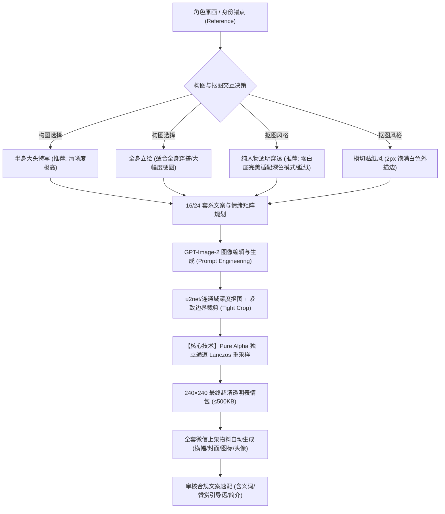

# WeChat Sticker Creator (微信表情包全流程制作指南)

本技能沉淀了从**单张角色立绘/设定图**出发，利用 AI 图像模型、计算机视觉抠图算法及图像通道重采样技术，全自动完成一套符合**微信表情开放平台**官方工业级标准（16 张或 24 张）表情包制作与物料打包的完整方法论。

---

## 核心流程全景



---

## 阶段一：构图选择与角色特征锚点规划

在开始生图前，**必须首先与用户确认两大核心参数**：

### 1. 构图模式选择（Framing Selection）

| 模式 | 构图定位 | 微信 240×240 下表现 | 适用场景与建议 |
| :--- | :--- | :--- | :--- |
| **半身大头特写**<br>*(Bust-up / Waist-up)*<br>**【强烈推荐】** | 截取胸部或腰部以上，**头部占全图 55%~65%** | **极致清晰锐利**。大眼睛、眼神光、微表情与手部道具纤毫毕现，无任何细节丢失。 | 日常聊天、情绪反馈、高频互动表情。<br>*（微信手机气泡仅 60~80 点，大头是行业公认最佳实践）* |
| **全身立绘**<br>*(Full-body)* | 从头顶到脚底鞋靴完全可见，头部占约 15%~20% | 细节密集。由于 240 像素限制，五官相对小，适合大屏幕查看或导出 512+ 自定义表情。 | 需要展示特殊鞋袜、大裙摆复杂穿搭，或躺平咸鱼、抱膝缩成一团、倒立等全身肢体梗图。 |

### 2. 抠图透明度风格选择（Cutout Style）

1. **纯人物透明穿透（Pure Cutout，推荐默认）**：
   - 彻底剔除任何外围贴纸底衬、白色轮廓框；
   - 发丝缝隙、画笔与帽子之间、尾巴与手臂之间的空隙**完全透明穿透**；
   - **完美融入微信深色模式（纯黑/深灰底）** 以及用户的任何自定义聊天壁纸，毫无违和感。
2. **模切贴纸白边风（Die-cut Sticker with 2px Stroke）**：
   - 具备 2px 饱满白色外描边，类似物理不干胶贴纸；
   - 适合深色模式下为纯黑发角色提供轮廓保护（若角色已有亮色发饰或浅色衣服，建议直接选纯人物透明）。

### 3. 角色不变特征锚点（Identity Invariants）
在提示词开头必须严格锁定角色的不可变特征（每次调用必须重复）：
- **发型与发色**：如 `long black hair with dark blue highlights, cat/wolf ears with white inner fluff`；
- **核心服饰与配饰**：如 `black artist beret with paintbrushes and white paint splatters, 'Z' badge, white turtleneck sweater with black bow tie, draped oversized jacket`；
- **标志性尾巴/翅膀/物件**：如 `huge fluffy white fox tail, paint bucket, paintbrush`；
- **画风与比例**：`chibi anime character, bold clean ink outlines`。

---

## 阶段二：生图提示词工程与防错模板

### 1. 半身大头特写（Bust-up / Waist-up）黄金 Prompt 模板

```text
A close-up waist-up / bust-up chibi anime illustration based on the exact character from the image (<角色不变特征锚点>).
Framing & Composition: Waist-up close-up portrait framing (半身大头特写), large cute chibi head occupying 60% of the canvas, big expressive sparkling eyes, prominent cute face, holding props close to cheek, huge fluffy tail framing her shoulder. Well-centered with negative space around the character.
Action & Pose: <具体动作描写，如：Cheerful open-mouthed smile, cute wink, happily waving paintbrush>.
Art Style & Isolation: Crisp clean black ink lineart, vibrant solid anime colors, isolated directly on a seamless solid pure flat white background #FFFFFF.
CRITICAL NEGATIVE: ABSOLUTELY NO sticker border, NO white die-cut outline, NO white halo around hair, NO paper edge, NO badge silhouette, NO full body, NO legs, NO boots, NO smoke, NO fog, NO water spray.
Text & Typography: Display the Chinese text '<简短文字>' prominently at the bottom in bold cute rounded cartoon font.
```

### 2. 全身立绘（Full-body）黄金 Prompt 模板

```text
A full-body chibi messaging sticker based on the exact character from the image (<角色不变特征锚点>).
Framing & Composition: Full-body character framing (全身立绘), completely visible from head to toe including shoes, boots, skirt, and tail, perfectly centered with ample negative space around the character.
Action & Pose: <具体全身动作描写，避免隐喻动词，全部实体化>.
Art Style & Isolation: Crisp clean black ink lineart, vibrant colors, isolated on pure white background #FFFFFF.
CRITICAL NEGATIVE: NO smoke, NO fog, NO vapor, NO steam, NO water spray, NO bubbles coming out of mouth. Completely clear view of face, body, and props.
Text & Typography: Display the Chinese text '<简短文字>' prominently at the bottom in cute bubbly rounded cartoon font.
```

---

## 阶段三：高质量抠图与抗预乘降采样

微信深色模式（Dark Mode）与各类壁纸要求背景绝对透明、边缘刀切般锐利。

### 标准执行流程：
1. **智能去底与连通域分离**：
   - 使用 `rembg` (u2net) 结合外围白色连通域分析，彻底移除背景；
   - 保证浅色毛发（如白尾巴、白毛衣）饱满保留，绝不发虚发灰；
2. **紧致裁剪 (Tight Crop)**：使用 `cutout.getbbox()` 裁剪掉空白边缘，使有效主体等比居中；
3. **【核心技术】分离 R, G, B, A 四通道独立 Lanczos 下采样**：
   - 彻底解耦 RGBA 四通道，分别执行独立 Lanczos 降采样后重新合并；
   - 杜绝传统缩放造成的 Premultiplied Alpha 灰边与锯齿；
   - 对 RGB 通道施加适度微锐化（UnsharpMask），确保在 240×240 官方尺寸下字符与眼神光极其清晰。

脚本工具：`scripts/process_stickers.py`
```bash
# 纯人物透明穿透模式（推荐，零白底，完美适配深色模式与任意壁纸）
python scripts/process_stickers.py <input_folder_or_file> <output_240_folder> --pure-cutout

# 传统模切贴纸白边模式（添加 2px 饱满白色外描边）
python scripts/process_stickers.py <input_folder_or_file> <output_240_folder> --stroke
```

---

## 阶段四：全套微信上架物料全自动构建

微信表情平台提交时，除主表情包外，**必须**上传以下全套配套图片：

| 物料名称 | 规范尺寸 | 格式 | 大小限制 | 关键硬性红线 |
| :--- | :---: | :---: | :---: | :--- |
| **表情封面图** | 240 × 240 | 透明 PNG | $\le$ 500 KB | 选用整套中最具代表性的 1 张表情透明图 |
| **聊天面板图标** | 50 × 50 | 透明 PNG | $\le$ 100 KB | 主头像等比缩小，作为输入法键盘切换图标 |
| **详情页横幅** | 750 × 400 | PNG/JPEG | **$\le$ 80 KB** | **严禁任何文字！严禁纯白底！**（用温和彩色底） |
| **艺术家主页横幅** | 750 × 400 | JPEG | **$\le$ 80 KB** | **严禁任何文字！严禁纯白底！** |
| **艺术家头像** | 640 × 640 | PNG/JPEG | $\le$ 500 KB | 正方形角色头像，不贴边，$\le$ 500 KB |

一键生成脚本：
```bash
python scripts/build_materials.py <选中的最佳表情_240.png> <头像原图.png> <输出物料目录>
```

---

## 阶段五：审核合规文案与红线标准

微信审核对文案字数与标点有程序化校验拦截，务必遵守以下字数红线：

1. **表情包名称**：严格 $\le 8$ 个汉字（如：`小画师的日常`）；
2. **表情包简介**：严格 $\le 80$ 个汉字（描述 IP 身份与使用场景）；
3. **含义词（每个表情必填）**：**1 ~ 4 个汉字**，**绝对禁止输入标点符号**！
   - 例如：`问好`、`收到`、`点赞`、`比心`、`思考`、`赶稿`、`摸鱼`；
4. **版权信息**：严格 $\le 10$ 个汉字（如：`个人原创作品`）；
5. **赞赏引导语**：严格 $\le 15$ 个汉字（打赏弹窗提示，如：`投喂一桶颜料，助力小画师产粮！`）；
6. **赞赏致谢语**：严格 $\le 20$ 个汉字（打赏后反馈，如：`感谢大人的投喂，小画师充满动力啦！`）。

---

## 快速实战调用 SOP

当用户唤醒技能时，执行标准化流程：
1. **需求采集与决策**：
   - 确认角色立绘（或协助用户从零设计角色原画）；
   - 明确**构图模式**（半身大头特写【推荐】vs 全身立绘）；
   - 明确**抠图风格**（纯人物透明穿透【推荐】vs 模切贴纸白边）；
   - 确认制作套数（16 张或 24 张）；
2. **规划方案**：列出分镜头动作及对应的简短文案与含义词（$\le 4$字无标点）；
3. **小批量试跑验证**：先生成 1~3 张让用户过目清晰度与抠图效果；
4. **批量全量生成**：调用生图模型与 `scripts/process_stickers.py` 执行无损抗预乘缩图；
5. **物料打包**：运行 `scripts/build_materials.py` 生成全套 Banner、Cover、Icon、Avatar；
6. **交付物料与文案表**：生成结构化合规文案速查表，直接供创作者在后台粘贴提交！
